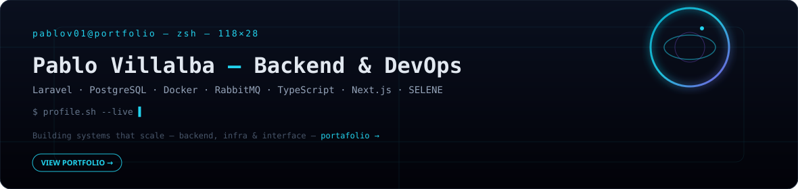
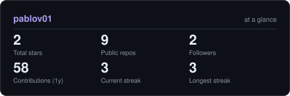
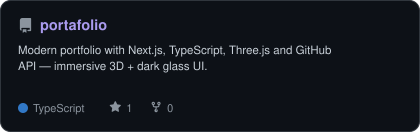
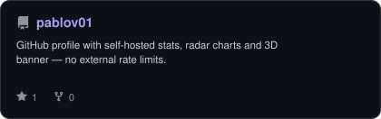

<div align="center">

<!-- BANNER — generated SVG (live SELENE site at portafolio) -->
<picture>
  <source media="(prefers-color-scheme: dark)" srcset="assets/banner-dark.svg">
  <source media="(prefers-color-scheme: light)" srcset="assets/banner-light.svg">
  
</picture>

<a href="https://github.com/pablov01/portafolio">
  
</a>

<br>

<a href="https://github.com/pablov01"></a>&nbsp;&nbsp;
<a href="https://www.linkedin.com/in/pablov01/"></a>&nbsp;&nbsp;
<a href="https://github.com/pablov01/portafolio"></a>

<br>


<a href="https://github.com/pablov01/portafolio"></a>

</div>

---

## About

I build **backend systems, scalable applications and automation workflows** focused on maintainability, performance and clean architecture.

> `portafolio/` is the live Next.js portfolio — this profile is its GitHub mirror. Single source of truth: [`portafolio/src/data/profile.ts`](https://github.com/pablov01/portafolio/blob/main/src/data/profile.ts), [`portafolio/src/data/projects.ts`](https://github.com/pablov01/portafolio/blob/main/src/data/projects.ts) and [`portafolio/src/data/site.ts`](https://github.com/pablov01/portafolio/blob/main/src/data/site.ts) → synced to `pablov01/assets/*.json`.

Currently interested in:
- Backend Engineering
- DevOps & CI/CD
- System Architecture
- Automation
- Cybersecurity

**→ Live portfolio:** [`pablov01/portafolio`](https://github.com/pablov01/portafolio) — **SELENE** visual system: `Earthrise.tsx` (scroll-pinned lunar scene rendered from layered assets + canvas dust), `WorkReel.tsx` (horizontal project reel), `Trajectory.tsx` (SVG orbital timeline) and `Capabilities.tsx`. Résumés in English and Spanish under `public/documents/`.

---

## Core Stack

<p align="left">
  
</p>

Backend — Laravel, PHP, Node.js, Python, FastAPI, Java, Spring, REST APIs, RabbitMQ

### Familiar With

<p align="left">
  
</p>

Frontend — React, Next.js, Vue, TypeScript, Tailwind CSS | DevOps — Docker, Kubernetes, Terraform, Grafana, GitHub Actions, CI/CD, Linux, Bash | Databases — PostgreSQL, MySQL, MongoDB, Elasticsearch

---

## Featured Projects

> Unified with `portafolio/src/data/projects.ts` — edit there, this README updates via cards.

| Project | Stack | Links |
|---|---|---|
| **Developer Portfolio** · SELENE editorial portfolio with scroll-driven lunar scenes | Next.js, TypeScript, Tailwind, Lenis, GitHub API | [repo](https://github.com/pablov01/portafolio) |
| **Financial Cooperative System** · Scalable financial workflows | Laravel, PostgreSQL, Docker, Queues | *private — owned by employer* |
| **DevOps Monitoring Stack** · Observability + automated deploys | Docker, Grafana, CI/CD, Linux | — |
| **Automation & Integration Services** · Async workers + service integrations | Laravel, RabbitMQ, APIs, Queues | — |

---

## Signals — Skills

<div align="center">

<table>
<tr>
<td width="50%" align="center" valign="middle">

<!-- Self-rated radar — edit assets/skills.json -->
<picture>
  <source media="(prefers-color-scheme: dark)" srcset="assets/radar-dark.svg">
  <source media="(prefers-color-scheme: light)" srcset="assets/radar-light.svg">
  
</picture>

</td>
<td width="50%" align="center" valign="middle">

<!-- Stack radar — edit assets/stack.json -->
<picture>
  <source media="(prefers-color-scheme: dark)" srcset="assets/radar-stack-dark.svg">
  <source media="(prefers-color-scheme: light)" srcset="assets/radar-stack-light.svg">
  
</picture>

</td>
</tr>
</table>

</div>

---

## GitHub Activity

> Self-hosted — no `github-readme-stats` rate limits. Generated by `scripts/cards.py` + `lowlighter/metrics`.

<div align="center">

<picture>
  <source media="(prefers-color-scheme: dark)" srcset="assets/card-stats-dark.svg">
  <source media="(prefers-color-scheme: light)" srcset="assets/card-stats-light.svg">
  
</picture>

<br>

<picture>
  <source media="(prefers-color-scheme: dark)" srcset="assets/card-portafolio-dark.svg">
  <source media="(prefers-color-scheme: light)" srcset="assets/card-portafolio-light.svg">
  
</picture>
<picture>
  <source media="(prefers-color-scheme: dark)" srcset="assets/card-pablov01-dark.svg">
  <source media="(prefers-color-scheme: light)" srcset="assets/card-pablov01-light.svg">
  
</picture>

<br>


</div>

---

## SELENE — the visual system

GitHub can't run WebGL or scroll animations, so the profile keeps static equivalents. The live experience is in the portfolio:

- **`portafolio/src/components/Earthrise.tsx`** — 400vh pinned hero: layered lunar `webp` art (sky, earth, moonscape, frame, astronaut, ground), canvas dust motes, scroll-driven parallax and a HUD with Asunción clock.
- **`portafolio/src/components/WorkReel.tsx`** — horizontally pinned project reel driven by `scroll.ts` + `pinProgress()`, reading live repo stars from the GitHub API.
- **`portafolio/src/components/Trajectory.tsx`** — SVG orbit (Earth → Moon) that draws the path as you scroll and maps the four career legs.
- **`portafolio/src/components/Capabilities.tsx`** — backend / DevOps / full-stack capability cards generated from `SKILL_GROUPS`.
- **`portafolio/src/components/ContactSection.tsx`** — contact channels plus downloadable résumés (EN / ES).
- **Banner fallback** in this repo: `assets/banner-dark/light.svg` — generated by `scripts/generate-banner.py`.

Run locally: `cd portafolio && npm install && npm run dev` → http://localhost:3000 (scroll to move through the scenes, reduced-motion is respected).

---

## Sync — keep both repos consistent

```bash
# single source of truth lives in portafolio/
# after editing portafolio/src/data/{profile,projects,site}.ts:
python scripts/sync-from-portafolio.py   # copies SKILLS_RADAR/STACK_RADAR/projects → assets/*.json + regenerates radar/banner
```

Or edit `assets/*.json` directly — next `charts.yml` run will redraw the SVGs.

---

## Connect

<p align="left">
  <a href="https://github.com/pablov01" target="_blank"></a>
  <a href="https://www.linkedin.com/in/pablov01/" target="_blank"></a>
</p>

<div align="center">

<sub>Built with `Next.js` · `SELENE` · self-hosted GitHub cards · synced data — inspired by <a href="https://github.com/emmi-lili/emmi-lili">emmi-lili</a></sub>

</div>
